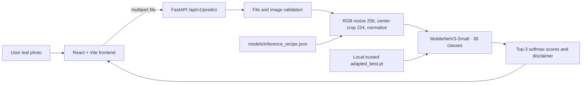
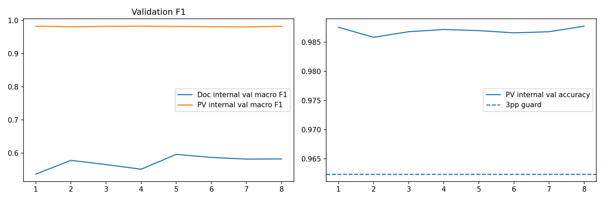
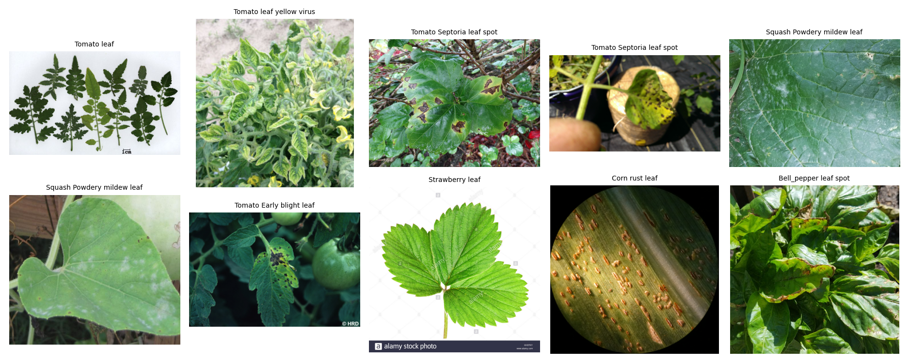
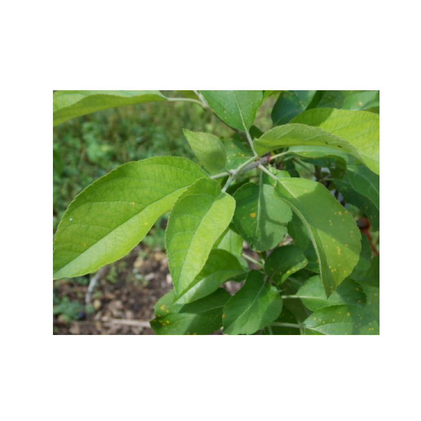

# LeafDoctor Lite · Day 31/100

**Agriculture · Computer Vision · Responsible visual leaf-condition screening**

[Dokumentasi Bahasa Indonesia](docs/id/README.md) · [English documentation](docs/en/README.md) · [Model details](models/README.md) · [Research reports](reports/README.md)

> **Research prototype, not an agronomic diagnosis.** A model score is an uncalibrated softmax value, not a verified probability of disease. Seek qualified agronomic review before treatment decisions.

## Executive summary

LeafDoctor Lite helps farmers and extension workers conduct a **preliminary visual screening** of supported leaf photographs. The project combines a 38-class PlantVillage-trained MobileNetV3-Small baseline with PlantDoc source-train adaptation, an auditable Kaggle notebook, existing held-out evaluation reports, a modular FastAPI inference service and a responsive React/Vite client. It is **not** validated for geographically independent farms or production decision-making.

**Repository evidence:** [notebook](notebooks/leafdoctor-lite.ipynb), [model card](models/MODEL_CARD.json), [inference recipe](models/inference_recipe.json), [paired metrics](reports/paired_test_metrics.csv), [split audit](reports/audit/split_counts.json), [dataset provenance](reports/metadata/dataset_provenance.json), [backend](backend/app/main.py), [frontend](frontend/src/pages/App.tsx).

## Application screenshot


*Local application screenshot uploaded to the repository. It demonstrates UI rendering and a single inference interaction; it does not establish diagnostic correctness or field performance.*

## Problem, people, and use cases

- **Problem:** Early leaf symptoms are ambiguous and a specialist may not be immediately available.
- **Intended users:** Farmers, agricultural extension workers, students and researchers who understand that this is preliminary screening.
- **Use case:** Upload one readable leaf image; inspect top-3 model class scores and uncertainty; export a JSON summary; seek expert follow-up.
- **Research question:** Does adaptation using selected, mapped PlantDoc source-train samples improve performance on the matched PlantDoc test subset while maintaining PlantVillage validation performance within the predefined tolerance?
- **Non-goals:** Definitive diagnosis, pesticide/treatment prescription, species identification outside supported classes, severity assessment, detection, segmentation, offline deployment or universal field accuracy.

## Before → Now → Next

| Phase | Evidence-based status |
|---|---|
| Before | PlantVillage baseline, PlantDoc mapping/duplicate audits and adaptation experiment recorded in [notebook](notebooks/leafdoctor-lite.ipynb) and [reports](reports/). |
| Now | API and frontend source exist; user locally confirmed `/api/v1/ready` returning `model_ready: true` with 38 classes, production frontend build passing, and one image producing a displayed result. These observations are **local**, not CI or formal deployment verification. |
| Next | Add automated checkpoint-level inference tests, run reproducible end-to-end tests, evaluate confidence calibration and more independent farm images, improve accessibility and ensure artifact distribution. |

## System architecture & workflow



The backend exposes `/api/v1/health` (does not load the model), `/api/v1/ready` (loads and validates checkpoint), and `/api/v1/predict` (multipart image). The frontend uses the configured API origin or the Vite development proxy. The original class ordering in the inference recipe is the source of truth.

## Actual features and maturity

| Capability | Status and evidence |
|---|---|
| 38-class inference logic | Implemented in [engine.py](backend/app/inference/engine.py), requires separately available trusted `.pt` weights |
| Real file upload, JPEG/PNG/WebP validation | Implemented in [route](backend/app/api/routes/predict.py) and [frontend](frontend/src/pages/App.tsx) |
| Top-3 classifications and uncertainty disclaimer | Implemented; softmax is **not calibrated** |
| Recent analyses | Browser session-only; not a server database |
| JSON export | Implemented in frontend |
| Backend smoke and negative-input tests | Defined in [tests](backend/tests/test_api.py); no CI verification reported |
| Cloud deployment | **Not verified** |
| Field diagnostic reliability | **Not established** |

## Data provenance & licensing

The experiment's provenance file identifies **PlantVillage** ([original dataset](https://huggingface.co/datasets/mohanty/PlantVillage)) and **PlantDoc** ([source repository](https://github.com/pratikkayal/PlantDoc-Dataset)), prepared at Kaggle path `/kaggle/input/datasets/loliwibu/leafdoctor-dataset`. The provenance metadata records generation at **2026-11-04 13:57 UTC**, **not** the acquisition date or immutable dataset version. It does **not** verify rights to redistribute original images. Read upstream license terms before use or redistribution. No raw image dataset is shipped in this repository.

See [provenance](docs/en/dataset_provenance.md) and [audit files](reports/audit/). Code license is in [LICENSE](LICENSE); it does not automatically license third-party datasets or checkpoints.

## Dataset and split audit

The audit records **PlantVillage train 38,360 / val 5,231 / official test 10,709** and **PlantDoc source-train 1,497 / internal val 327 / mapped test 182**. The PlantDoc full test contains **236** entries, so **182 is only a mapped subset**, not a full PlantDoc score. Test-set label coverage in mapped evaluation is **22 ground-truth classes**, not all 38 model outputs. PlantVillage has 38 class outputs. The experiment quarantined **9 conflicting SHA-256 groups involving 18 source images** (including 8 test images), removed reported exact train/test overlaps, and does not claim to exclude perceptual near-duplicates or same-plant leakage. Exact group rules and counts: [split counts](reports/audit/split_counts.json), [quarantine evidence](reports/audit/plantdoc_conflict_quarantine_summary.json).

## Modeling, preprocessing and selection

- `torchvision.mobilenet_v3_small`, **38 ordered labels** in [`inference_recipe.json`](models/inference_recipe.json).
- Inference: RGB → resize shortest edge 256 → centered 224×224 crop → `ToTensor` → ImageNet mean `[0.485,0.456,0.406]` and std `[0.229,0.224,0.225]` → softmax.
- Experiment config in [config.json](reports/metadata/config.json): seed 42, batch 64, base LR 0.00015, adaptation LR 0.00006, weight decay 0.0001, PlantDoc sampling share 0.4, patience 3.
- Baseline: PlantVillage training. Adapted candidate: PV train with mapped PlantDoc source-train mixture. Recorded selection criterion: **PlantDoc source-train internal-validation macro-F1** subject to **PV validation accuracy no more than 3 percentage points below baseline**. The model card reports selected adaptation epoch **5**.
- Final paired tests are **not** checkpoint-selection criteria.

## Experimental results — held-out tests

These values are transcribed from [`reports/paired_test_metrics.csv`](reports/paired_test_metrics.csv), not independently rerun here.

| Dataset / split | Model | n | Accuracy | Macro-F1 | Balanced accuracy |
|---|---|---:|---:|---:|---:|
| PlantVillage official test | PV baseline | 10,709 | 98.59% | 98.16% | 98.02% |
| PlantVillage official test | Field-adapted | 10,709 | 98.24% | 97.57% | 97.33% |
| PlantDoc mapped test | PV baseline | 182 | 26.37% | 24.55% | 27.46% |
| PlantDoc mapped test | Field-adapted | 182 | 62.09% | 61.76% | 61.27% |

**Interpretation:** Adaptation improved the *mapped* PlantDoc test accuracy by approximately **35.71 percentage points** (26.37 → 62.09), while PlantVillage official-test accuracy decreased by approximately **0.35 percentage points** (98.59 → 98.24). These numbers are valid only for their stated subsets. Do **not** compare with the historical V1 score of 26.06% on a **different 165-image subset** ([comparability note](reports/comparability_note.txt)). See [per-class and confusion-matrix files](reports/README.md); no single aggregated cross-dataset accuracy is claimed.

## Evidence gallery

### Adaptation learning curves

*Recorded adaptation history visualization. Consult [adaptation_history.csv](reports/adaptation_history.csv) for actual epochs and quantities.*

### Paired test comparison

*Separate datasets, separate test samples and class coverage; do not interpret as an overall deployment accuracy.*

### PlantDoc source-image examples

*Examples of the dataset domain. Examples do not establish ground-truth accuracy for uploaded field images.*

### Recorded inference example

*Example image used in a local screening demonstration; do not treat this image as a held-out accuracy benchmark.*

## Reproducibility & model artifacts

- Source notebook: [`notebooks/leafdoctor-lite.ipynb`](notebooks/leafdoctor-lite.ipynb).
- Reproducibility context: [provenance JSON](reports/metadata/dataset_provenance.json) records Python 3.13.16, PyTorch 2.11.0+cu130, torchvision 0.26.0+cu130 for the **recorded Kaggle run**; this is distinct from local application requirements.
- Expected local weights: `models/adapted_best.pt`; fallback **only if absent**: `models/baseline_pv_best.pt`. Weight files are `.gitignore`d, **not uploaded to GitHub**. A matching filename alone does not authenticate provenance; obtain a trusted checkpoint and verify it before loading.
- Notebook artifacts include reports, histories, maps, audit CSVs and model card. `models/adapted_mobilenetv3_scripted.pt` was observed locally but is **not** the `.pt` state-dict path used by the current backend.

## Local setup (Windows PowerShell)

**Backend** (Python environment with matching PyTorch and torchvision):

```powershell
cd "D:\porto\100 day\day 31\LeafDoctor Lite\backend"
python -m venv .venv
.\.venv\Scripts\python.exe -m pip install -r requirements.txt
.\.venv\Scripts\python.exe -m pytest -v
.\.venv\Scripts\python.exe -m uvicorn app.main:app --host 127.0.0.1 --port 8000 --reload
```

In another terminal:

```powershell
cd "D:\porto\100 day\day 31\LeafDoctor Lite\frontend"
npm ci
npm run build
npm run dev
```

Visit `http://127.0.0.1:5173`. With backend running and a trusted local checkpoint placed in `models/`, call `http://127.0.0.1:8000/api/v1/ready` to verify readiness. Upload an actual image in the frontend. The `Analyze leaf` button is disabled until an image is selected. Vite's development proxy forwards `/api` to FastAPI. See [backend guide](backend/README.md), [frontend guide](frontend/README.md), and [troubleshooting](docs/en/troubleshooting.md).

### Example API commands

```powershell
Invoke-RestMethod http://127.0.0.1:8000/api/v1/health
Invoke-RestMethod http://127.0.0.1:8000/api/v1/ready
curl.exe -X POST http://127.0.0.1:8000/api/v1/predict -F "file=@C:\path\to\leaf.jpg"
```

`.env.example` is only a template: backend presently reads process environment variables `MODEL_PATH`, `DEVICE`, `CORS_ORIGINS`, `MAX_UPLOAD_MB`, and `MAX_IMAGE_PIXELS` via `os.getenv` and does **not** automatically load `.env` from disk. Frontend `VITE_API_URL` is a **build-time** variable. See [deployment notes](docs/en/deployment.md).

## Testing and safety

The repository includes negative-input API tests for invalid media type, invalid image data and empty input. User-reported local verification established checkpoint loading with strict state-dict validation, frontend TypeScript/Vite build success, and one image displayed with model outputs. It does **not** demonstrate general correctness, statistical confidence calibration, CI test coverage, or production readiness. Files uploaded to the demo are decoded in memory, with no application-level persistence in the current route. Use trusted checkpoints only: model deserialization can be risky.

## Known limitations and claim boundaries

Domain shift, mixed source quality, weak PlantDoc healthy proxy labels, partial mapped test coverage, exact-hash-only leakage controls, uncertain calibration, possible unsupported conditions and lack of independent geographic testing. **Image classification is not object detection, segmentation, crop-management advice, or guaranteed disease diagnosis.** See [limitations](docs/en/limitations.md).

## Repository layout

```text
.
├── README.md · AGENTS.md · LICENSE · .env.example · .gitignore
├── notebooks/leafdoctor-lite.ipynb
├── models/{MODEL_CARD.json,inference_recipe.json,README.md}
├── reports/{audit/,metadata/,paired_test_metrics.csv,README.md,...}
├── assets/{plots/,examples/,screenshots/,diagrams/,README.md}
├── backend/{app/,tests/,requirements.txt,README.md,AGENTS.md,README_APP.md}
├── frontend/{src/,package.json,package-lock.json,README.md,AGENTS.md,README_APP.md}
├── docs/{id/,en/,README.md}
└── scripts/README.md
```

Existing `assets/diagrams/` contains only a `.gitkeep` at audit time; the architecture diagram above is Mermaid source rendered in this document, **not a nonexistent image file**.

## Roadmap / priorities

1. **P0:** Re-run local backend tests with trusted weights; smoke-test `/predict` against labeled images and record outputs; ensure backup build files are excluded from Git.
2. **P1:** Provide versioned, checksummed weight distribution without violating original rights; add CI and API contract tests.
3. **P1:** Independent farm photo evaluation and confidence calibration; improve out-of-distribution warnings.
4. **P2:** Improve mobile UX, a11y, history controls and deployment security controls after tests.

## Troubleshooting & FAQ

- **Model not loaded?** Ensure local weights exist, run `/api/v1/ready`; `/health` checks status without loading.
- **Frontend cannot connect?** Run FastAPI on port 8000, confirm Vite proxy and CORS for non-proxy deployments.
- **Is 62.09% a general field accuracy?** No; it is *182-image mapped PlantDoc test accuracy*.
- **Why no model checkpoint on GitHub?** Large / potentially restricted artifacts are ignored; see [models README](models/README.md).
- **Can it recommend pesticides?** No; not in scope.

## Documentation, license, and attribution

- [Complete Indonesian docs](docs/id/README.md) · [Complete English docs](docs/en/README.md)
- [API implementation](backend/app/api/routes/predict.py) · [frontend source](frontend/src/pages/App.tsx) · [research model card](models/MODEL_CARD.json)
- Project [LICENSE](LICENSE) applies to repository code/content as specified in that file, **not** automatically to original PlantVillage/PlantDoc data.
- Dataset attribution: [PlantVillage](https://huggingface.co/datasets/mohanty/PlantVillage) and [PlantDoc](https://github.com/pratikkayal/PlantDoc-Dataset).
