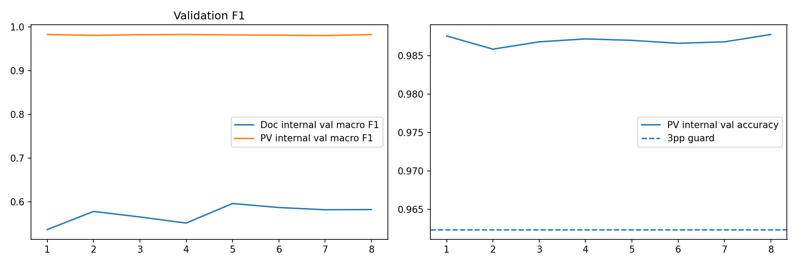
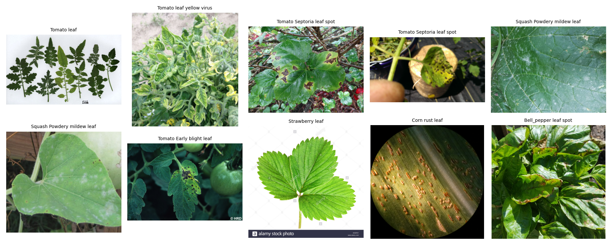
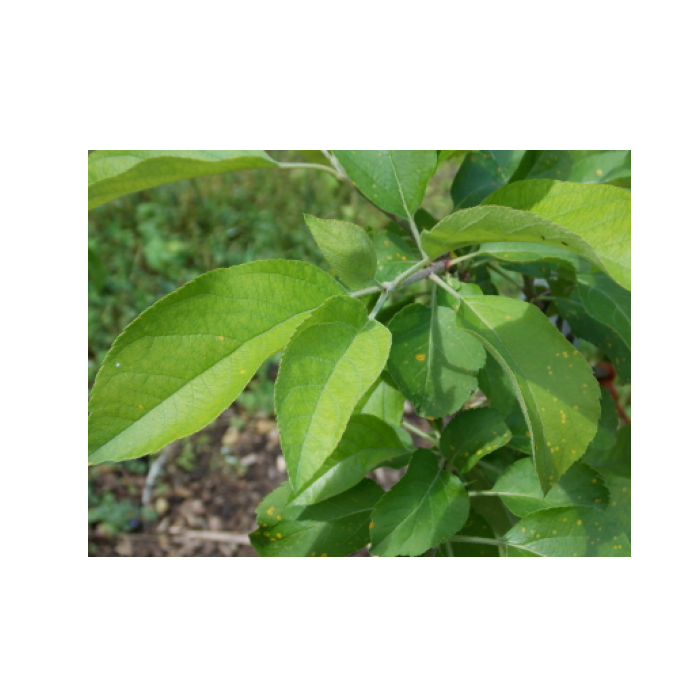

# Visual evidence gallery

Every embedded path below has been checked against the GitHub repository tree. These are **real committed files**, not placeholder graphics.

## Experiment plots

*Recorded adaptation training history; quantitative lineage: [`../reports/adaptation_history.csv`](../reports/adaptation_history.csv).*

*Accuracy comparison across the two **different** test datasets; not a single generalization metric.*

## Input and examples

*PlantDoc-style source images associated with the experiment; not independent field validation.*

*Representative input image. Do not present as a test-set accuracy case without a verified label and split.*

## Application

*Local user screenshot showing an inference result. Successful display is distinct from correct diagnosis.*

## Inventory rules

- `plots/`: only genuine plots derived from experiment reports.
- `examples/`: actual source images and predictions (e.g. [`examples/predictions/paired_test_predictions.csv`](examples/predictions/paired_test_predictions.csv)); do not relabel examples without provenance.
- `screenshots/`: captured running application; retain capture context.
- `diagrams/`: currently no committed architecture graphic (only `.gitkeep`); render the architecture Mermaid in the [root README](../README.md) instead.
- Respect dataset image licenses, privacy and attribution; avoid committing raw dataset dumps or deceptive decorative stock imagery.
