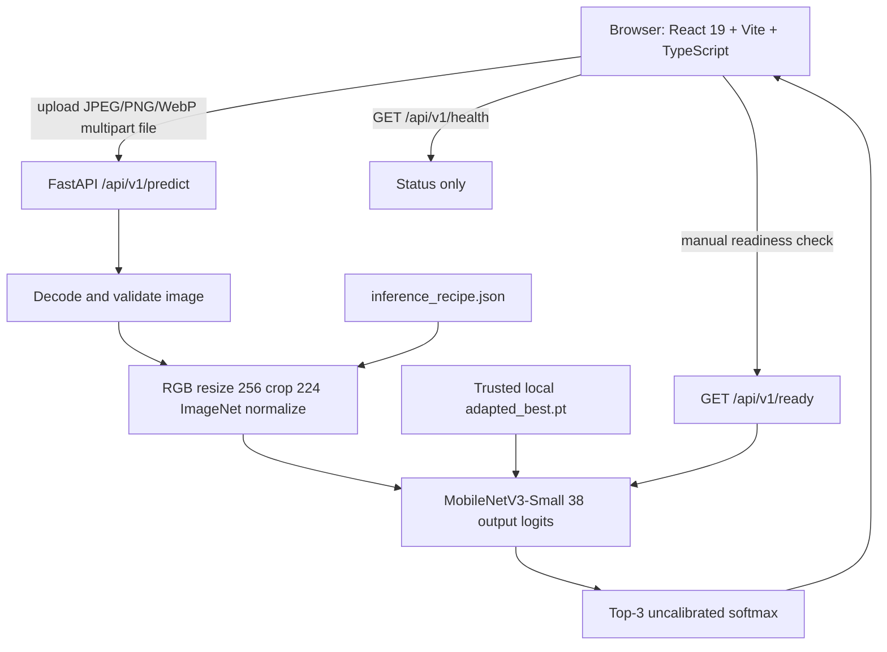

# System architecture and API contract

## Components and data flow



`backend/app/main.py` registers `backend/app/api/routes/predict.py`. Model code lives in [`engine.py`](../../backend/app/inference/engine.py); uploads in [`images.py`](../../backend/app/services/images.py). CORS and limits are specified in [`settings.py`](../../backend/app/core/settings.py). Frontend [`App.tsx`](../../frontend/src/pages/App.tsx) controls upload/preview/result/history and [`api.ts`](../../frontend/src/services/api.ts) performs network calls.

## API summary

| Verb / path | Request | Response / important behavior |
|---|---|---|
| `GET /api/v1/health` | none | `status`, `model_ready`, `model_name`, `classes`, `detail`; may show model not loaded even when model file exists |
| `GET /api/v1/ready` | none | model loading/validation; 200 if ready, 503 if missing/bad checkpoint |
| `POST /api/v1/predict` | multipart `file` | prediction with crop/condition/score, top predictions, disclaimer, uncertainty note, model metadata and image dimensions |

Example:

```powershell
curl.exe -X POST http://127.0.0.1:8000/api/v1/predict -F "file=@C:\path\to\leaf.jpg"
```

## Deployment boundaries and navigation

React uses same-page anchored sections, not multipage routing; history is client session scoped. Vite proxies `/api` to FastAPI for local development; set `VITE_API_URL` and backend `CORS_ORIGINS` appropriately for split production origins. No persistent inference database or user identity service exists. The model checkpoint is not distributed in GitHub; never claim a clean clone is immediately prediction-ready. Current cloud architecture and infrastructure logging are not verified.
