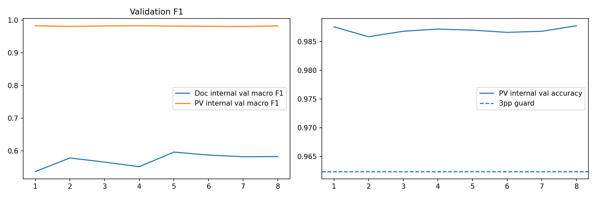

# Experiment design and checkpoint selection

## Baseline and candidate

- **PV baseline:** MobileNetV3-Small trained on the recorded PlantVillage training split with its own validation sequence; see [`pv_baseline_history.csv`](../../reports/pv_baseline_history.csv).
- **Field-adapted candidate:** mixture training with PV training and mapped PlantDoc source-training images; history in [`adaptation_history.csv`](../../reports/adaptation_history.csv).
- Config: [seed 42 and hyperparameters](../../reports/metadata/config.json); [audited sample counts](../../reports/audit/split_counts.json).

## Selection, comparability and test isolation

The recorded model card states the champion was chosen by **PlantDoc source-train internal validation macro-F1**, constrained by PlantVillage **validation** accuracy not dropping more than 3 percentage points from the PV baseline. Selected adaptation epoch: **5**. Held-out PlantVillage official test and mapped PlantDoc test must not be used to choose epochs or tune class mappings. The test comparisons in [`paired_test_metrics.csv`](../../reports/paired_test_metrics.csv) are on paired test samples for each named dataset. PlantDoc V1 historical 26.06% / 165 images is not directly comparable with V2's 182-image mapping, as explained in [`comparability_note.txt`](../../reports/comparability_note.txt).

## Evidence and interpretation

*Plots relate to [`adaptation_history.csv`](../../reports/adaptation_history.csv); the plot is not an independent run reproduced by this documentation update.*

*Adaptation is more robust than baseline on the mapped PlantDoc subset but remains below universal field performance expectations; test datasets cannot be averaged naively.*

## Artifacts to inspect

[Model card](../../models/MODEL_CARD.json), [paired metrics](../../reports/paired_test_metrics.csv), [per-class tables](../../reports/README.md), [notebook](../../notebooks/leafdoctor-lite.ipynb). Training history CSVs should be checked when interpreting early stopping and epoch settings. No new training was performed for these documents.
