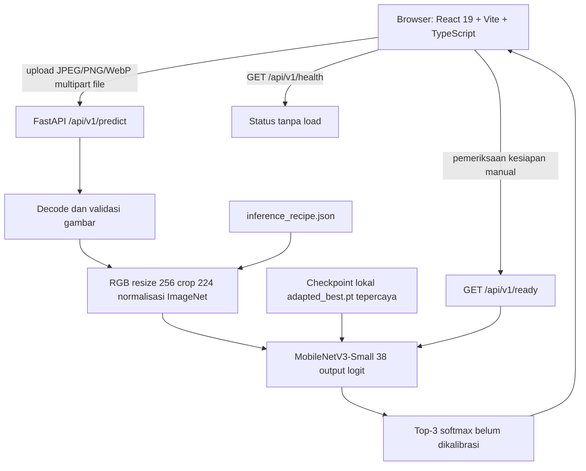

# Arsitektur sistem dan kontrak API

## Komponen dan alur data



`backend/app/main.py` mendaftarkan `backend/app/api/routes/predict.py`. Kode model pada [`engine.py`](../../backend/app/inference/engine.py); upload pada [`images.py`](../../backend/app/services/images.py). CORS dan batas input di [`settings.py`](../../backend/app/core/settings.py). Frontend [`App.tsx`](../../frontend/src/pages/App.tsx) mengelola upload/preview/hasil/riwayat dan [`api.ts`](../../frontend/src/services/api.ts) mengirim request.

## Ringkasan API

| Metode / path | Request | Respons dan perilaku |
|---|---|---|
| `GET /api/v1/health` | tidak ada | `status`, `model_ready`, `model_name`, `classes`, `detail`; bisa belum loaded walau file ada |
| `GET /api/v1/ready` | tidak ada | memuat/memvalidasi model; 200 siap, 503 jika checkpoint hilang/tidak cocok |
| `POST /api/v1/predict` | multipart `file` | prediksi tanaman/kondisi/skor, tiga kelas, disclaimer, uncertainty note, metadata model dan dimensi gambar |

Contoh:

```powershell
curl.exe -X POST http://127.0.0.1:8000/api/v1/predict -F "file=@C:\path\to\leaf.jpg"
```

## Batas deployment dan navigasi

React menggunakan bagian halaman dengan anchor, bukan routing multipage; riwayat hanya tersimpan selama sesi browser. Vite melakukan proxy `/api` ke FastAPI saat dev; sesuaikan `VITE_API_URL` dan `CORS_ORIGINS` untuk origin produksi terpisah. Tidak ada database inferensi permanen atau layanan identitas. Checkpoint tidak tersedia dalam GitHub; clone baru belum otomatis siap prediksi. Arsitektur cloud dan log infrastruktur belum diverifikasi.
