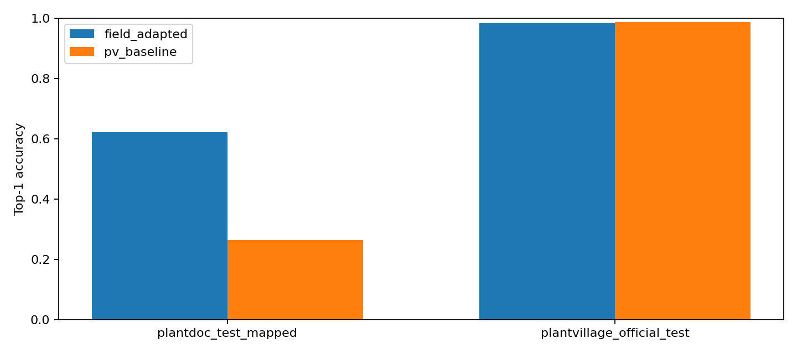

# Evaluasi, bukti per-kelas, dan interpretasi

## Pengujian held-out berpasangan

Sumber: [`paired_test_metrics.csv`](../../reports/paired_test_metrics.csv). Angka adalah hasil **tercatat**, tidak dijalankan ulang dalam perubahan dokumentasi.

| Dataset / split | Model | n | Accuracy | Macro-F1 | Balanced accuracy |
|---|---|---:|---:|---:|---:|
| PlantVillage official test | PV baseline | 10,709 | 98.59% | 98.16% | 98.02% |
| PlantVillage official test | Field-adapted | 10,709 | 98.24% | 97.57% | 97.33% |
| PlantDoc mapped test | PV baseline | 182 | 26.37% | 24.55% | 27.46% |
| PlantDoc mapped test | Field-adapted | 182 | 62.09% | 61.76% | 61.27% |

Subset mapped test PlantDoc berisi **182 gambar dan 22 kelas ground truth** (dari full source test 236 gambar), sementara model tetap mengeluarkan 38 kategori. Official test PlantVillage berisi 10.709 sampel dan 38 kelas ground truth. Akurasi subset PlantDoc model adaptasi naik 35,71 percentage points dari baseline PV; akurasi test resmi PlantVillage turun 0,35 percentage points. Keduanya bukan jaminan akurasi deployment.

## File sumber per-kelas dan confusion matrix

| Test / checkpoint | Per-kelas | Confusion |
|---|---|---|
| PlantDoc mapped / adapted | [CSV](../../reports/field_adapted_plantdoc_test_mapped_perclass.csv) | [CSV](../../reports/field_adapted_plantdoc_test_mapped_confusion.csv) |
| PlantDoc mapped / baseline | [CSV](../../reports/pv_baseline_plantdoc_test_mapped_perclass.csv) | [CSV](../../reports/pv_baseline_plantdoc_test_mapped_confusion.csv) |
| PV official / adapted | [CSV](../../reports/field_adapted_plantvillage_official_test_perclass.csv) | [CSV](../../reports/field_adapted_plantvillage_official_test_confusion.csv) |
| PV official / baseline | [CSV](../../reports/pv_baseline_plantvillage_official_test_perclass.csv) | [CSV](../../reports/pv_baseline_plantvillage_official_test_confusion.csv) |

File tersebut harus dipakai untuk meneliti kegagalan tiap kelas; jangan membuat gambar confusion matrix fiktif ketika repository hanya menyimpan CSV. [Prediksi berpasangan per-sampel](../../assets/examples/predictions/paired_test_predictions.csv) mendukung error analysis dengan memperhatikan provenance dan privasi.

*Plot asli di repository; jangan mencampur metrik split.*

## Ancaman validitas

Seleksi memakai validation menurut model card, tetapi subset test PlantDoc terbatas, filter hash eksak tidak menangkap near-duplicate perseptual, proxy healthy generik berpotensi salah, domain shift besar, dan confidence belum dikalibrasi. Subset V1 historis tidak setara. Respons API yang sukses atau satu prediksi masuk akal **bukan** bukti statistik diagnosis tepat. Tidak ada metrik deteksi/segmentasi karena proyek ini klasifikasi.
