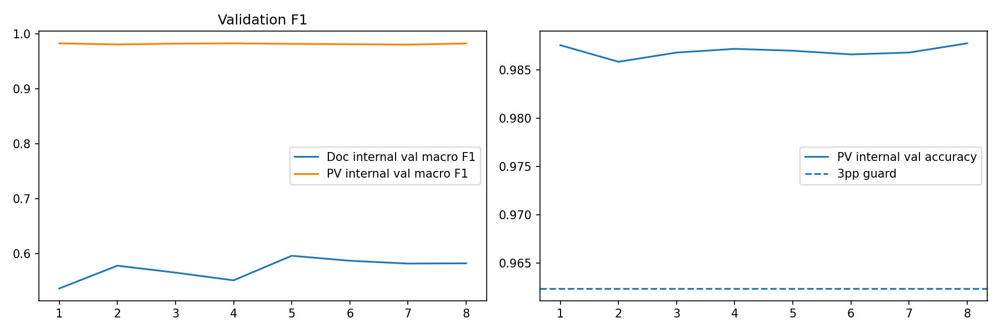

# Desain eksperimen dan pemilihan checkpoint

## Baseline dan kandidat

- **Baseline PV:** MobileNetV3-Small dilatih pada train PlantVillage dengan validation sendiri; lihat [`pv_baseline_history.csv`](../../reports/pv_baseline_history.csv).
- **Kandidat adaptasi lapangan:** pelatihan campuran PV train dan gambar source-train PlantDoc terpetakan; history pada [`adaptation_history.csv`](../../reports/adaptation_history.csv).
- Konfigurasi: [seed 42 dan hyperparameter](../../reports/metadata/config.json); [jumlah sampel audit](../../reports/audit/split_counts.json).

## Seleksi, komparabilitas, isolasi test

Model card mencatat champion dipilih berdasarkan **macro-F1 internal validation source-train PlantDoc** dengan syarat akurasi **validation** PlantVillage tidak turun lebih dari 3 percentage points dari baseline PV. Epoch adaptasi terpilih: **5**. Test resmi PlantVillage dan test PlantDoc terpetakan tidak digunakan untuk memilih epoch maupun menyetel mapping label. Perbandingan test pada [`paired_test_metrics.csv`](../../reports/paired_test_metrics.csv) memakai sampel pasangan yang sama untuk tiap dataset. V1 historis 26,06% / 165 gambar tidak bisa dibandingkan langsung dengan V2 182 gambar; lihat [`comparability_note.txt`](../../reports/comparability_note.txt).

## Bukti dan interpretasi

*Plot terkait [`adaptation_history.csv`](../../reports/adaptation_history.csv); dokumentasi ini tidak menjalankan training baru.*

*Adaptasi lebih baik pada subset PlantDoc terpetakan, tetapi belum membuktikan performa umum kebun; metrik dua dataset tidak boleh dirata-ratakan sembarangan.*

## Artefak untuk ditinjau

[Model card](../../models/MODEL_CARD.json), [metrik pasangan](../../reports/paired_test_metrics.csv), [tabel per kelas](../../reports/README.md), [notebook](../../notebooks/leafdoctor-lite.ipynb). History CSV perlu dicocokkan untuk interpretasi early stopping dan epoch. Tidak ada training baru pada perubahan dokumentasi ini.
